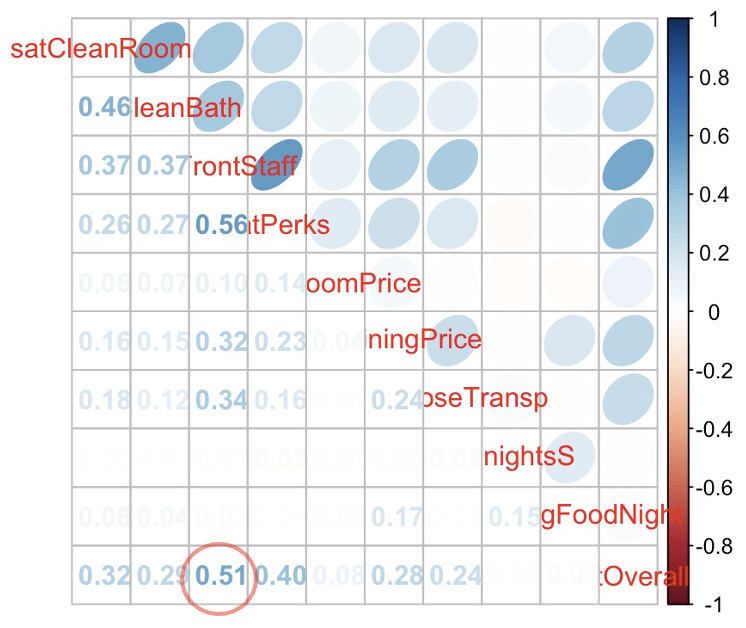
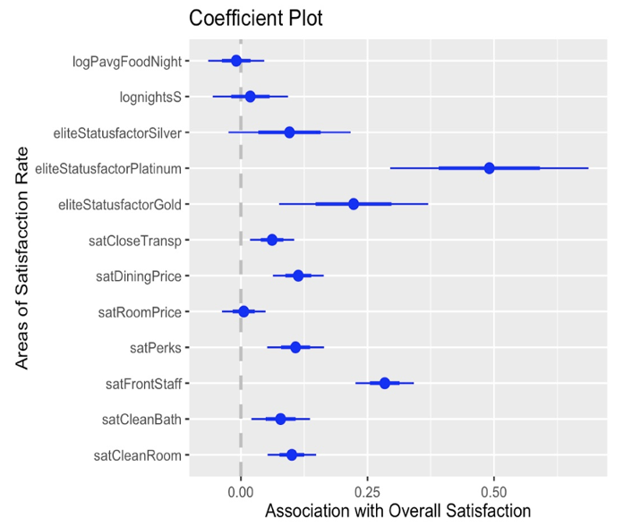
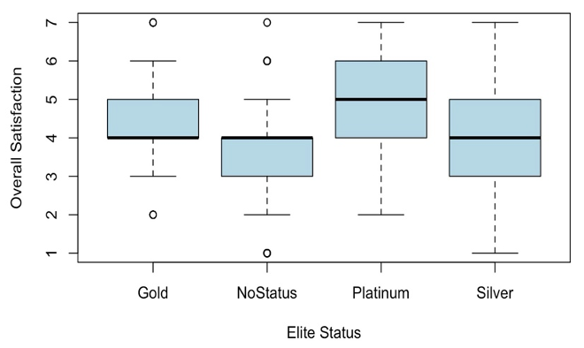
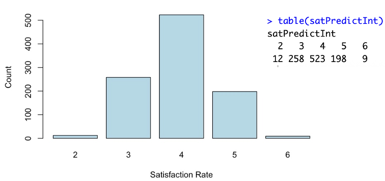

# Predicting and Improving Hotel Customer Satisfaction

Multiple regression in R to find what drives overall guest satisfaction in a hotel dataset, followed by a prescriptive linear programming model that allocates a limited budget and labour time to the most effective improvements.

## Business Problem
Which factors most strongly drive overall customer satisfaction at the hotel, which guest groups are least satisfied, and how can the hotel improve satisfaction in an economical way? The project moves from prediction ("what influences satisfaction?") to prescription ("what should the hotel do next, given a limited budget and staff time?").

## Data
- **Source:** 
- **Size:** 1,500 guest observations across 24 variables
- **Contents:** 17 satisfaction ratings on a 1–7 scale
- **Variables used:** `satOverall` (outcome), `satFrontStaff`, `satCleanRoom`, `satCleanBath`, `satPerks`, `satRoomPrice`, `satDiningPrice`, `satCloseTransp`, `nightsStayed`, `avgFoodSpendPerNight` and `eliteStatus` (NoStatus, Silver, Gold, Platinum)
- **Preparation:** no missing values and a single rating scale. Therefore, no standardisation was needed. The skewed variables `nightsStayed` and `avgFoodSpendPerNight` were log-transformed (`log1p()` for food spend because of zero values).

## Tools Used
R (data preparation, correlation analysis, regression models, diagnostics and prediction)

## Approach
- Explored the data with summaries, boxplots, a scatterplot matrix, histograms and a correlation plot to check its suitability for modelling
- Built five nested regression models, from a simple model with front staff satisfaction alone to a multiple regression with all service ratings, log-transformed variables and loyalty status
- Compared models using R-squared and ANOVA, and chose model 5 (loyalty status with NoStatus as the reference group) as the final model
- Checked residual diagnostics, used the model to predict satisfaction for new guests and examined its limitations
- Built a prescriptive linear programming model that maximises expected satisfaction under budget, labour-hour and cleaning-policy constraints

## Key Findings
**1.What drives satisfaction**
- **Front staff service is the strongest driver.** It is the only rating with a correlation of 0.50 or more with overall satisfaction, and each 1-point increase adds about 0.28 points to overall satisfaction (other factors held constant)
- Room and bathroom cleanliness, perks, dining price and location have smaller but statistically significant effects
- Room price, nights stayed and food spend per night have little or no significant effect

**2.Model fit**
- Front staff alone explains 25.6% of the variation in satisfaction. The final model explains about 32%, so most of the variation remains unexplained

**3.Loyalty status**
- Platinum members rate 0.49 points higher than guests with no status, and Gold members 0.22 points higher
- Silver status is not significantly different from NoStatus
- Guests with no loyalty status are the least satisfied group and make up over 36% of guests (544 of 1,500), so improving their experience matters for retention and revenue

**4.Limitations**
- Predictions are compressed towards the middle of the scale (mostly between 2 and 6), so the model rarely predicts very high or very low satisfaction
- Some predictors may be correlated with each other (for example room and bathroom cleanliness), which can make coefficients unstable

## Visuals

*Correlation between overall satisfaction and the other ratings*


*Effect of each variable on overall satisfaction (model 5)*


*Overall satisfaction by loyalty status*


*Predictions cluster around the mean, a known limitation of linear regression*

## Prescriptive Model (Linear Programming)
The two strongest drivers, front staff service and room cleanliness, were turned into three decisions for the hotel:

- **X1:** front staff training sessions per month
- **X2:** complimentary welcome packages for new guests per month
- **X3:** rooms cleaned to a higher standard per month

```
Maximise Z = 0.284·X1 + 0.284·X2 + 0.101·X3

Subject to
  1·X1 + 0.1·X2 + 0.5·X3 ≤ 120      (labour hours per month)
  100·X1 + 5·X2 + 15·X3 ≤ 5000      (monthly budget, $)
  0.6·X1 + 0.06·X2 − 0.2·X3 ≤ 0     (at least 60% of hours on cleaning)
  X1, X2, X3 ≥ 0
```

The objective coefficients come from the regression model (front staff 0.284, room cleanliness 0.101). The cost and time figures are stated assumptions, and the model assumes each initiative lifts the related rating by about one point.

## Recommendations
1. **Invest in front office service:** train staff in customer care, responsiveness and communication, set clear service standards, collect regular guest feedback and offer welcome packages to new guests
2. **Maintain room and bathroom cleanliness:** use strict housekeeping checklists and regular audits, and focus cleaning time on rooms with more complaints
3. **Improve the experience of guests with no loyalty status:** keep service quality equal for every guest, not just elite members, to reduce the risk of losing over a third of the guest base
4. **Treat the model as a guide, not an exact answer:** combine it with staff knowledge and historical data, pilot the prescriptive plan before a full rollout and handle guest data in line with privacy rules

## Repository Structure
```
hotel-customer-satisfaction-r/
├── README.md
├── scripts/       ← R code
├── data/          ← hotel dataset
└── images/        ← charts used in this README
```

## How to Run
1. Install R and RStudio
2. Install the packages used in the script: `[gpairs, corrplot, coefplot]`
3. Download the dataset from the source above and keep the file in the `data/` folder
4. Open `scripts/hotel_sat.R` in RStudio
5. Check that the file path at the top of the script matches your folder, then run it from top to bottom

## Author
Hashen Rathnayake | [LinkedIn](https://www.linkedin.com/in/hashen-rathnayake-074885207/)
